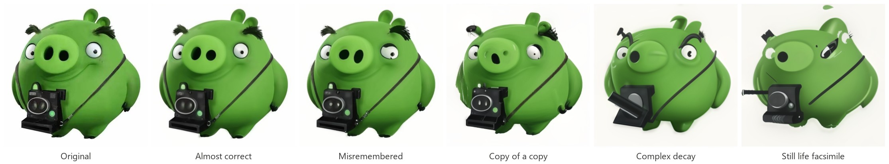
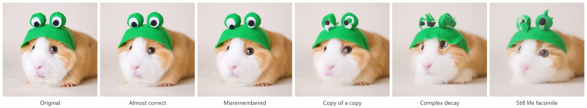

<p align="center">
  
</p>

<h1 align="center">Still Life AI</h1>

<p align="center">
  <b>English</b> · <a href="README.ru.md">Русский</a>
</p>

A desktop app that tries to remember your picture the way the Complex does in
Kane Pixels' *The Backrooms* ("Still Life"), and almost gets it right. The image
stays sharp and recognizable, but its parts are in the wrong places: eyes,
nostrils, teeth, letters and spots are moved, swapped, turned around or forgotten.

## Examples





## How it works

1. The picture is scaled to about 448 px on the long side.
2. **Misreading.** Color segmentation finds separate elements (small,
   contrasting regions). Some of them are moved, swapped with a neighbor,
   rotated, mirrored, resized, duplicated or dropped. Large parts barely move,
   so the silhouette survives.
3. **Reconstruction.** SD-Turbo (img2img, 1–3 steps) redraws the result, heals
   the seams and keeps the style consistent. The strongest presets do a second
   pass: a copy of a copy.
4. **Anchor.** The original's details come back where nothing was moved, and its
   coarse layout and colors are mixed in everywhere, so even the strongest
   preset is clearly made from your picture.

## Installation

Windows 10/11 and Python 3.10–3.12. The first generation downloads the SD-Turbo
weights (~2.6 GB) into the Hugging Face cache.

```bat
py -3.12 -m venv .venv
.venv\Scripts\python -m pip install -r requirements.txt
```

This works for AMD, Intel and NVIDIA through DirectML, and for the CPU. To use
CUDA on an NVIDIA card, install the CUDA build of torch first:

```bat
.venv\Scripts\python -m pip install torch==2.4.1 --index-url https://download.pytorch.org/whl/cu124
.venv\Scripts\python -m pip install -r requirements.txt
```

All packages are pinned around `torch==2.4.1`, the version `torch-directml`
requires. The comments in [requirements.txt](requirements.txt) explain why.

## Usage

Double-click `run.bat`, or:

```bat
.venv\Scripts\python main.py [--device auto|cuda|dml|cpu] [--theme light|dark]
```

1. **Open image...** or drop a file into the window (PNG, JPG, WEBP, BMP).
2. Pick a preset: **Almost correct**, **Misremembered**, **Copy of a copy**,
   **Complex decay** or **Still life facsimile**.
3. **Generate**, then **Save result**.

The device is detected automatically (CUDA, then DirectML, then CPU) and shown
in the top bar. Next to it, **Load model / Unload model** loads SD-Turbo in
advance or frees its video memory. The model lives in a separate process, so
unloading really gives the memory back. Every run uses a new random seed.

On an RX 7600 a generation takes a few seconds. With DirectML the model takes
about 4 GB of VRAM, 6 GB after the first run. When memory runs out, the app
retries at a smaller size and then falls back to the CPU.

## Development

```bat
.venv\Scripts\python -m pip install pytest
.venv\Scripts\python -m pytest
```

The tests cover the effect curves, image loading, the out-of-memory cascade,
device selection, the window (headless) and the model process, using tiny
random models, so no weights are needed.

`tools/sweep.py photo.png` renders every preset side by side to tune the curves
in `core/misread.py` (`--no-model` skips SD-Turbo). Logs are written to
`logs/stilllife.log`.

```
main.py              entry point
config.py            model, service prompt, sizes
core/misread.py      presets, element shuffle, anchor
core/pipeline.py     passes, SD-Turbo engine, memory cascade
core/engine_process.py  model in a child process, device probe
core/device.py       CUDA / DirectML / CPU
ui/                  window, theme, widgets
tools/sweep.py       side-by-side comparison
docs/images/         logo and README examples
```

## License

The code is under the [MIT License](LICENSE). SD-Turbo
([stabilityai/sd-turbo](https://huggingface.co/stabilityai/sd-turbo)) is
distributed by Stability AI under its own license; check it before any
commercial use. The example pictures belong to their owners.

---

Made by [neodym121](https://github.com/neodym121) with the help of Claude Opus 5.5.
